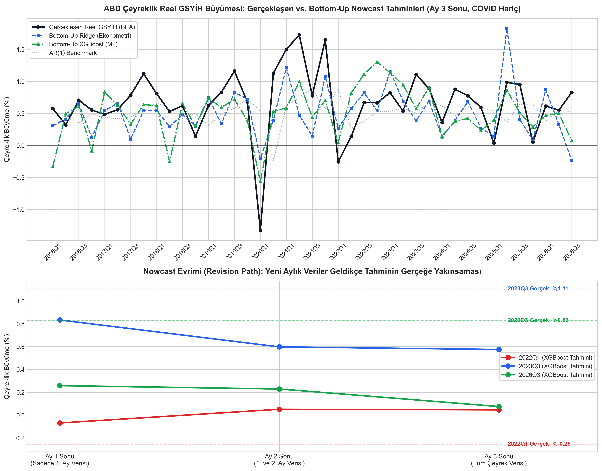

# US Real GDP Nowcasting: Bottom-Up U-MIDAS & Machine Learning Architecture

A central-bank-grade macroeconomic nowcasting pipeline inspired by the Federal Reserve Bank of Atlanta's **GDPNow** framework. Instead of forecasting headline GDP as a single black box, this system models the real quarterly growth rates of the five NIPA expenditure components—**Consumption ($C$), Investment ($I$), Government Spending ($G$), Exports ($X$), and Imports ($M$)**—using high-frequency monthly indicators from FRED, and aggregates them via dynamic lagged nominal GDP shares.



## Architectural Highlights

1. **Bottom-Up Expenditure Aggregation (Chained-Dollar Safe):**
   * Because BEA Chained (2017) Dollar series are non-additive across components, each sub-model predicts component-level real log-growth ($g_{i,t}$).
   * Headline real GDP growth is reconstructed using lagged nominal expenditure weights ($w_{i,t-1} = \frac{\text{Nominal } X_{i,t-1}}{\text{Nominal GDP}_{t-1}}$) satisfying the accounting identity $w_C + w_I + w_G + w_X - w_M = 1$.

2. **Mixed-Frequency Alignment (U-MIDAS):**
   * Monthly indicators are deflated into real terms using component-specific price indices (`CPIAUCSL`, `PPIACO`, `IQ`, `IR`), stationarized via log-differences, and mapped into quarterly feature vectors ($m_1, m_2, m_3$) via Unrestricted Mixed-Data Sampling (U-MIDAS) while keeping feature dimensionality compact (6–9 features per sub-model) to prevent small-sample overfitting.

3. **Zero-Leakage "Ragged Edge" & Asynchronous Release Handling:**
   * Real-time macro releases arrive asynchronously with varying publication lags. Missing intra-quarter months and unfinalized nominal weights are dynamically imputed at each vintage cutoff using rolling, leak-free `AR(1)` forecasts estimated strictly on available historical data.

4. **Econometric vs. Machine Learning Horse Race:**
   * **Bridge Equation (Standardized Ridge Regression):** Captures linear macro relationships under small-sample regularization.
   * **Gradient Boosted Trees (Shallow XGBoost):** Captures non-linear interactions across monthly indicator vintages (`max_depth=2`, `learning_rate=0.05`).
   * **Benchmark:** Unconditional `AR(1)` model on headline real GDP growth.

---

## Feature Mapping & Economic Rationale (FRED)

| Component | Target Series | Monthly Predictors | Deflator / Transformation | Economic Rationale |
| :--- | :--- | :--- | :--- | :--- |
| **Consumption ($C$)** | `PCECC96` | `RSAFS`, `DSPIC96`, `PAYEMS` | `CPIAUCSL` (for retail); MoM $\Delta \ln$ | Captures goods spending, real disposable purchasing power, and service-sector labor income. |
| **Investment ($I$)** | `GPDIC1` | `DGORDER`, `HOUST`, `INDPRO` | `PPIACO` (for orders); MoM $\Delta \ln$ | Tracks forward-looking capital equipment orders, residential construction, and industrial inventory dynamics. |
| **Government ($G$)** | `GCEC1` | `USGOVT`, `MTSO133FMS` | `PPIACO` (YoY $\Delta \ln$ for Treasury outlays) | Mirrors BEA public-sector value-added inputs (public payrolls) and federal fiscal expenditure flows. |
| **Exports ($X$)** | `EXPGSC1` | `BOPTEXP`, `DTWEXBGS` | `IQ` (Export Price Index); MoM $\Delta \ln$ | Directly tracks monthly real goods/services exports alongside broad USD price competitiveness. |
| **Imports ($M$)** | `IMPGSC1` | `BOPTIMP`, `TCU` | `IR` (Import Price Index); $\Delta \ln$ & $\Delta \text{TCU}$ | Tracks monthly real import flows and domestic capacity bottlenecks spilling over into foreign demand. |

---

## Pseudo Real-Time Backtest Results (2016Q1 – 2026Q3)

Evaluated via an **Expanding Window** simulation across three intra-quarter information vintages (**End of Month 1**, **Month 2**, and **Month 3**), masking extreme COVID-19 outlier quarters (`2020Q2`–`2020Q3`) during training:

| Information Vintage | AR(1) Benchmark RMSE | Bottom-Up Ridge RMSE | Bottom-Up XGBoost RMSE | AR(1) MAE | Ridge MAE | XGBoost MAE |
| :--- | :---: | :---: | :---: | :---: | :---: | :---: |
| **End of Month 1** *(Early Quarter)* | 0.565% | 0.564% | **0.485%** | 0.401% | 0.442% | **0.361%** |
| **End of Month 2** *(Mid Quarter)* | 0.565% | 0.616% | **0.487%** | 0.401% | 0.447% | **0.373%** |
| **End of Month 3** *(Full Quarter Data)* | 0.565% | 0.486% | **0.479%** | 0.401% | **0.378%** | 0.404% |

### Key Takeaways
* **Early-Quarter Advantage of ML:** When intra-quarter data is sparse (Months 1 and 2), **XGBoost reduces RMSE by ~14%** compared to the `AR(1)` benchmark (`0.485%` vs. `0.565%`), effectively detecting turning points such as the `2020Q1` and `2022Q1` contractions.
* **Late-Quarter Convergence of Bridge Equations:** Once all three monthly releases arrive (Month 3), **Ridge Regression** sharpens substantially (`0.486%` RMSE) and achieves the lowest overall **MAE (`0.378%`)**.

---

## Repository Structure

```text
├── gdp_nowcasting.ipynb          # End-to-end FRED pipeline, U-MIDAS, Ragged-Edge AR(1) imputation & backtest
├── gdp_nowcast_evaluation.png    # Backtest tracking & intra-quarter nowcast revision paths
├── requirements.txt              # Python dependencies
└── README.md                     # Project documentation
